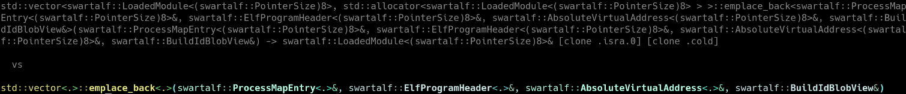

A demangler for the C++ Itanium ABI.

No dependencies besides the C++23 standard library.

Available as a command line tool or online.

Highlights:
- colored output
- can shorten output
- the parser accepts more code than c++filt or llvm-cxxfilt, including mangled requirements and constraints and pack indexing




The command line tool exports many options to shape the demangled output, including the option to preserve substitutions, which means the output size becomes linear in the input size, not exponential.

```
Options:
-r, --remangle
    demangle and remangle again
-g, --grammar
    dump grammar
-p, --partial
    allow partial parsing
-L, --light-mode
    change color scheme to light mode
-s, --short
    use a short representation
-S, --subs
    preserve substitutions in output
-T, --templ
    preserve template parameters in output
-P, --pack
    preserve packs in output
-R, --return
    do not show return types in output
-X, --expression
    do not show expressions
-t, --trailing
    show trailing return types in output
-F, --function-signature
    do not show function signatures in output
-o, --category=arg
    category (default is mangled_name)
-a, --dialect=arg
    demangling dialect, gnu or llvm
-d, --debug
    show verbose ouput
-l, --length=arg
    maximum length for demangled name
--function-params=arg
    maximum number of function parameters to display
--template-params=arg
    maximum number of template parameters to display
-c, --check
    compare against demangler from linked C++ runtime library
-W, --terminal-width=arg
    limit output to integer multiple of terminal width
```
